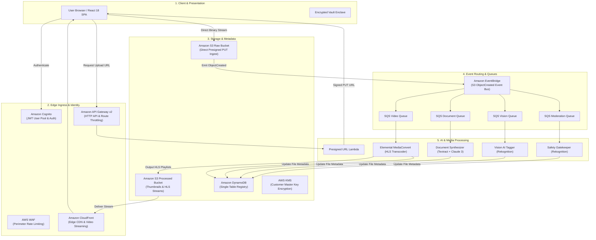
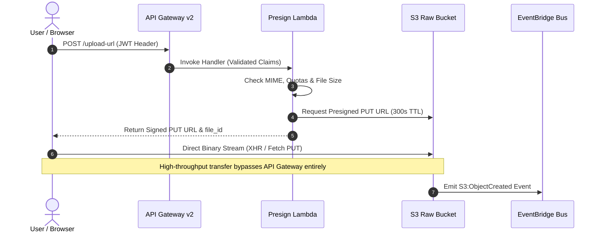

# OmniDrive AI — Technical Architecture & System Design

> **Engineering Reference: Event-Driven Serverless Media Intelligence & Cloud Storage**

---

## 1. System Overview

**OmniDrive AI** is an event-driven serverless cloud platform that converts static file storage into an active media intelligence workspace.

Instead of routing high-bandwidth binary uploads through traditional servers, clients upload directly to cloud storage using temporary signed URLs. Once a payload lands, an autonomous event mesh immediately triggers parallel serverless pipelines for:
* **Pre-Ingestion Safety Moderation**: Automated quarantine and filtering of non-compliant media.
* **Computer Vision Intelligence**: Autonomous scene recognition and tagging.
* **Document OCR & AI Synthesis**: Text extraction, spatial layout parsing, and executive AI summaries.
* **Adaptive Video Transcoding**: Broadcast-grade multi-bitrate HLS streaming (`1080p`, `720p`, `480p`, `360p`).
* **Zero-Knowledge Encrypted Vault**: Air-gapped vault protected by client-side SHA-256 PIN hashing and progressive brute-force rate-limiting.

---

## 2. Core Cloud Architecture

---

## 3. Active Cloud Services Matrix

| Service | Architecture Layer | Concrete Implementation in OmniDrive AI |
| :--- | :--- | :--- |
| **Amazon S3** | Ingestion & Storage | Dual-bucket topology separating raw client uploads from processed media assets. S3 Transfer Acceleration enabled for high-bandwidth uplinks. |
| **Amazon DynamoDB** | Database | Single-table schema (`omnidrive-ai-registry-dev`, `OmniDrive_Users`, `OmniDrive_ConsentLogs`) with on-demand capacity and sub-millisecond lookups. |
| **AWS Lambda** | Microservice Compute | Python 3.11 serverless handlers for presigned URL issuance, folder hierarchies, AI enrichment dispatching, and content indexing. |
| **Amazon API Gateway** | Gateway Ingress | Regional HTTP API v2 with native Cognito JWT authorizer, CORS preflight routing, and route token throttling. |
| **Amazon Cognito** | Identity & Auth | Secure User Pool directory, Secure Remote Password (SRP) authentication, short-lived JWT issuance, and session token renewal. |
| **Amazon CloudFront** | Edge CDN Delivery | Low-latency global edge network with Origin Access Control (OAC) for instant playback of adaptive HLS video manifests. |
| **Amazon EventBridge** | Event Routing Bus | Captures S3 `ObjectCreated` events and fans them out to decoupled processing queues. |
| **Amazon SQS** | Asynchronous Queuing | Worker queues (`moderation`, `video`, `vision`, `pdf`) with 14-day retention Dead Letter Queues (DLQs) for resilient fault recovery. |
| **AWS Elemental MediaConvert** | Media Transcoding | Automated 5-tier Adaptive Bitrate (ABR) HLS transcode pipeline generating 1080p, 720p, 480p, 360p, and 240p stream segments. |
| **Amazon Rekognition** | Computer Vision AI | Content moderation scanning (`detect_moderation_labels`) and visual categorization tag generation (`detect_labels`). |
| **Amazon Textract** | Document OCR | Multi-page text extraction, tabular recognition, and bounding-box parsing for PDF and scanned documents. |
| **Amazon Bedrock** | Generative AI | Foundation Model inference (Anthropic Claude 3 Haiku) generating executive document summaries and contextual insights. |
| **AWS KMS** | Cryptographic Security | Customer Master Key (CMK) managing envelope encryption for sensitive assets at rest in storage and database tiers. |
| **AWS WAF** | Perimeter Defense | Web Application Firewall defending API endpoints against automated scrapers, brute force, and OWASP Top 10 exploits. |
| **Amazon CloudWatch** | Observability | Centralized telemetry logging and threshold alarms monitoring Lambda execution errors and SQS DLQ backlogs. |
| **Amazon SNS** | Notification Topic | Multi-subscriber fanout publishing operational updates for completed transcodes, safety flags, and storage quota thresholds. |
| **AWS Systems Manager (SSM)** | Configuration Store | Parameter Store managing centralized application configurations, runtime flags, and model parameters. |

---

## 4. End-to-End Direct Streaming Pipeline

---

## 5. Security & Rate Limiting Framework

### Perimeter Defense
* **IP Rate Limiting**: Managed Web Application Firewall (WAF) tracks client IPs across a 5-minute sliding window. Any client exceeding **1,000 requests per 5 minutes** is temporarily blocked (HTTP 403 Forbidden).
* **Token-Bucket Throttling**: API Gateway default route enforcement restricts calls to a **1,000 req/sec steady-state rate** and a **500 request burst limit**, preventing microservice overload.
* **Brute-Force Lockouts**: Multi-tiered exponential delays and client-side lockouts defend user accounts and 4-digit Master PIN vaults against automated guessing attacks (15s cooldown at 3 attempts, 60s at 5, and 5 minutes at 8 attempts).

### Compliance & Governance
* **Zero Client Credentials**: No cloud secret keys or IAM credentials are ever bundled in client code.
* **India DPDP Act (2023) Alignment**: Explicit consent logs recorded with timestamps, IP hash, and audit trail in an immutable table before workspace activation.

---

*Copyright © 2026 OmniDrive AI. All rights reserved.*
