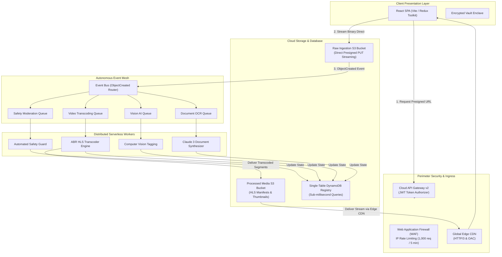

# OmniDrive AI

> **Cloud-Native Multimodal Intelligence & Autonomous Media Engine**  
> *Architected for high throughput, sub-second edge retrieval, and true $0 idle cost.*

---

## 📌 Executive Summary

**OmniDrive AI** reimagines personal and enterprise cloud storage. Rather than acting as a passive file repository, the platform functions as an **autonomous multimodal intelligence engine**. 

Built entirely on an **event-driven, serverless cloud mesh**, incoming binary uploads bypass intermediate API servers and stream directly to cloud storage via signed URLs. The moment a payload lands, an event bus fans out parallel processing pipelines for **automated safety inspection**, **deep computer vision analysis**, **multimodal document synthesis**, and **multi-bitrate adaptive video transcoding**.

---

## 🌟 Key Capabilities

* **⚡ Direct Binary Cloud Streaming**: High-speed chunked multipart uploads bypass compute proxies entirely, eliminating server bandwidth costs and memory bottlenecks.
* **👁️ Vision Intelligence**: Autonomous scene recognition, object detection, and automated metadata tagging for instant searchability.
* **📄 Multimodal Document Studio**: Optical Character Recognition (OCR), tabular extraction, and AI-powered document intelligence with conversational document Q&A.
* **🎬 Adaptive HLS Video Transcoder**: Automated generation of multi-bitrate HTTP Live Streaming playlists (`1080p`, `720p`, `480p`, `360p`) for smooth playback on any network.
* **🔐 Zero-Knowledge Encrypted Vault**: Air-gapped vault enclave protected by client-side SHA-256 master PIN verification and progressive brute-force rate-limiting.
* **🛡️ Edge Defense & Rate Limiting**: Multi-tier perimeter firewall protecting all endpoints with sliding-window IP rate limiting (1,000 req/5m) and burst token throttling.
* **🇮🇳 Statutory Compliance**: Built-in statutory data storage consent and audit trails aligned with India's **Digital Personal Data Protection (DPDP) Act, 2023**.

---

## 🏛️ System Architecture

---

## 📊 Core Architecture Matrix

| Architectural Layer | Implementation | Strategic Advantage |
| :--- | :--- | :--- |
| **Edge & API Gateway** | Regional HTTP API with JWT Authorizer | Sub-10ms ingress routing, stateless token verification |
| **Edge Firewall** | Managed WAF with IP Rate-Limiting Rules | Automated bot mitigation, SQLi/XSS inspection, DoS protection |
| **Object Storage** | S3 Transfer Acceleration + Lifecycle Tiering | Automatic transition to cold archival storage for idle media |
| **Event Routing** | Managed Event Bus with Fanout Pattern | Completely decoupled asynchronous processing pipelines |
| **Message Buffering**| Dedicated SQS Queues with Dead-Letter Queues | Zero message loss, resilient fault recovery, smooth backpressure |
| **Database** | DynamoDB Single-Table Schema | Global sub-millisecond lookups with zero connection-pool overhead |
| **Media Delivery** | CloudFront CDN with Origin Access Control | Encrypted edge caching, low-latency global video streaming |

---

## 🔒 Security & Defense-in-Depth

1. **Zero Client Secrets**: The frontend build contains zero cloud credentials, secret keys, or database URIs. All authenticated interactions use short-lived JWTs.
2. **Brute-Force Defense**: Progressive lockout tiers for login and vault access (15s cooldown at 3 attempts, 60s at 5, and 5 minutes at 8 attempts).
3. **Quarantine-on-Arrival**: Raw uploads reside in an unindexed staging zone until automated moderation inspects and clears the payload.
4. **Least-Privilege RBAC**: Every serverless worker operates under an isolated IAM execution role scoped strictly to its required queue and storage prefix.
5. **Data Protection & Privacy**: Enforces explicit data storage consent logs complying with India's DPDP Act, 2023.

---

## 📚 Technical Documentation

* [System Architecture & Services Portfolio](ARCHITECTURE.md) — Comprehensive technical breakdown of all 24 integrated cloud services.
* [Public API Interface Specification](API_SPECIFICATION.md) — Clean REST contract definitions and payload schemas.

---

## 📜 Intellectual Property & Disclaimer

*This repository is a public architectural showcase and technical portfolio. The proprietary backend implementation, microservice source code, and cloud infrastructure definitions are maintained in a secure, private repository.*

**Designed & Engineered by [Abinash Gope](https://github.com/Abinash-Gope)**  
*Copyright © 2026 OmniDrive AI. All rights reserved.*
